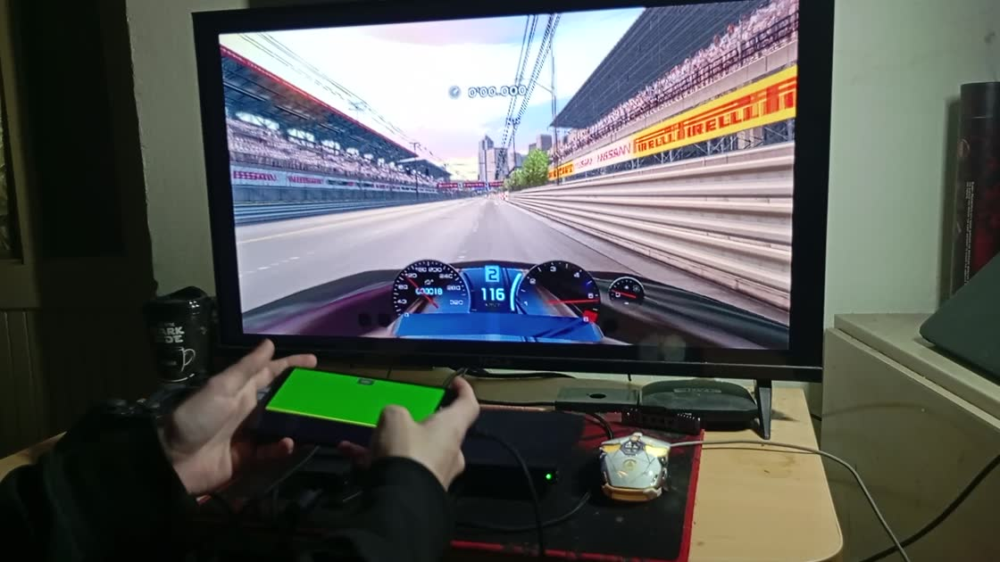

# MotionPad v1.0

### Turn an Android phone into a motion-steering wheel and game controller for a **real PlayStation 2** — or a Windows PC.

**Real hardware · USB tethering · Android motion controls · Free PS2 & Windows companions**

[**Project website**](https://motionpad.pages.dev/) · [**Watch the real PS2 demo**](https://pub-5acd44ee2d36470481e5e0bc8d19c58d.r2.dev/VID_20261023_223106.mp4) · [**Report an unsupported game**](https://motionpad.pages.dev/#report-game)

*Click the image to watch the original real-hardware demonstration.*

## About

MotionPad began as an experiment: **could an Android phone steer an actual PlayStation 2 game?** After developing and testing the connection, the answer was yes. MotionPad now has three v1.0 components:

| Component | What it does | Distribution |
| --- | --- | --- |
| **MotionPad Android** | Motion steering, touchscreen throttle/braking, and on-screen controller layouts | Android app; see website for current availability |
| **MotionPad PS2 ELF** | Free McBoot-compatible PS2-side application, developed using **Open PS2 Loader (OPL)** as a foundation | **Free** companion; OPL-derived source planned for publication |
| **MotionPad Windows Receiver** | Connects the Android app to Windows through virtual controller input, for PC games and emulators including PCSX2 | **Free** companion; source private |

The Android app communicates with the PS2 over a USB-tethered connection. The Windows Receiver provides a separate route for PC gaming.

## Features

- **Tilt to steer:** Android motion sensors provide analog steering input.
- **Touch throttle and brake:** Up/down touchscreen controls designed for racing.
- **Full gamepad layout:** On-screen analog sticks and buttons.
- **Play on real hardware:** Uses a Free McBoot-compatible PS2 ELF.
- **PC support:** A dedicated receiver and installer for Windows games and PCSX2.

## Confirmed on real PS2 hardware

| Game | Status |
| --- | --- |
| Gran Turismo 3 | ✅ Working |
| Gran Turismo 4 | ✅ Working |
| Gran Turismo 4 Spec II | ✅ Working |
| Tourist Trophy | ✅ Working |
| Need for Speed: Carbon | ✅ Working |

These are the titles reported as working in the project's real-console testing. **Unlisted games are unverified, not necessarily incompatible.** See [compatibility notes](docs/COMPATIBILITY.md).

## Quick start

**PS2:** Install/run Free McBoot, connect Android to the PS2 with a USB data cable, enable USB tethering, launch `MotionPad.elf`, then start a supported game. The current PS2 setup also requires a physical controller in **Port 1**. See [setup notes](docs/SETUP.md).

**Windows / PCSX2:** Install and open MotionPad Windows Receiver, connect Android by USB and enable USB tethering, then configure the virtual controller in your game or emulator. See [setup notes](docs/SETUP.md).

Get downloads and the latest setup instructions at **[motionpad.pages.dev](https://motionpad.pages.dev/)**.

## Testers wanted 🎮

I'm looking for owners of **real PlayStation 2 consoles** and users of **PCSX2 / Windows PC games** to test more titles, report input or compatibility problems, and suggest improvements.

- **[Report a game compatibility result](../../issues/new?template=game-compatibility.yml)** using the issue template after this repository is published.
- **[Open a bug report](../../issues/new?template=bug-report.yml)** for controller, tethering, or Receiver problems.
- Or use the [MotionPad contact options](https://motionpad.pages.dev/#report-game).

Please include the **game title, region/version, console or PCSX2 setup, what works, and what fails**. No copyrighted game images, ISO files, or BIOS dumps are needed.

## Source-code scope and attribution

- The **PS2 ELF** is based on **Open PS2 Loader (OPL)**. OPL is licensed under **AFL-3.0**; original notices, third-party licenses, and modification acknowledgements must be preserved when publishing the actual source. See [source and license notes](docs/SOURCE-AND-LICENSES.md).
- The **Android app** and **Windows Receiver** source code are **not public**. This repository is intended for the PS2-side open-source work, documentation, and compatibility tracking.
- **Important:** This starter repository contains project documentation and a real-hardware demonstration still. It does **not** claim to contain the complete PS2 buildable source until those files are added and their licenses audited.

MotionPad is an independent homebrew project. It is not affiliated with Sony, Polyphony Digital, the PCSX2 team, or the original OPL contributors.
